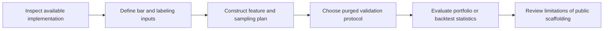
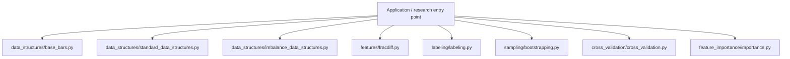
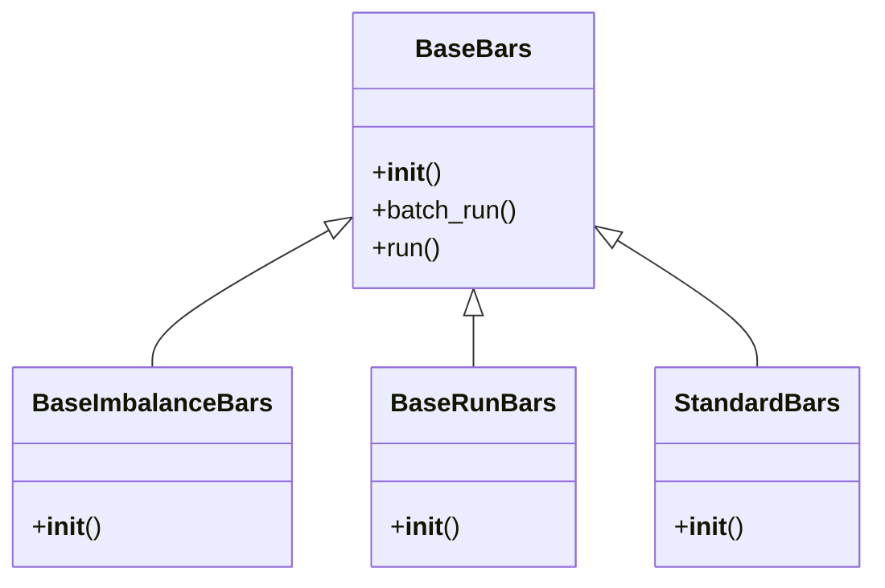
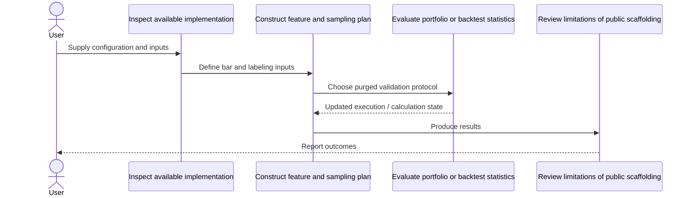
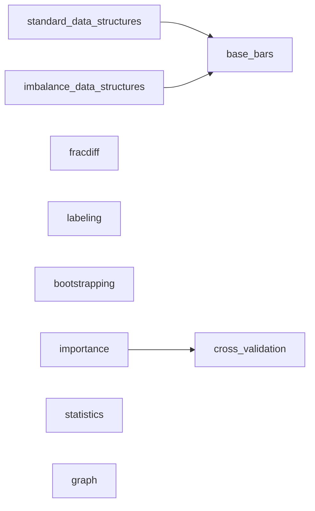
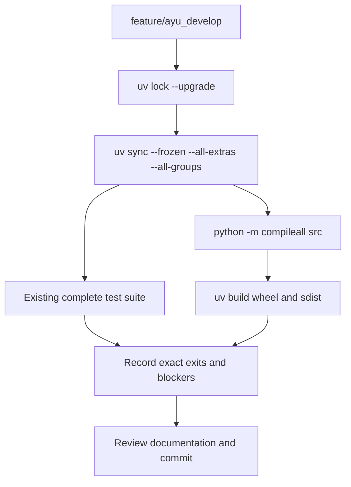

# mlfinlab: development, architecture and operations

Updated 2026-10-12 on `feature/ayu_develop`; source snapshot `86a8aba0d287`. This guide follows the source in this checkout and separates available interfaces from verification evidence.

## Purpose and feature boundaries

Financial machine-learning API scaffolding for bars, labeling, fractional differentiation, sampling, cross validation, portfolio research and network analysis.

This public checkout contains many pass bodies and documented interfaces rather than complete production algorithms. The diagrams describe the documented research composition and actual class declarations; they are not evidence that all mathematical workflows execute. No test suite is present in this checkout. TensorFlow, NumPy and Numba availability is an environment constraint, not a substitute for implementation validation.

## Main workflow

The following is the repository-specific logical workflow. Runtime execution details remain in the linked source and the validation record.

1. Inspect available implementation.
2. Define bar and labeling inputs.
3. Construct feature and sampling plan.
4. Choose purged validation protocol.
5. Evaluate portfolio or backtest statistics.
6. Review limitations of public scaffolding.

## Components and ownership

The entry point composes the source modules below; arrows indicate review/navigation boundaries rather than a claim that every module is called in every run.

| Source | Declared classes / functions | Implementation role |
|---|---|---|
| [src/mlfinlab/data_structures/base_bars.py](../src/mlfinlab/data_structures/base_bars.py) | BaseBars, BaseImbalanceBars, BaseRunBars; _crop_data_frame_in_batches | A base class for the various bar types. Includes the logic shared between classes, to minimise the amount of |
| [src/mlfinlab/data_structures/standard_data_structures.py](../src/mlfinlab/data_structures/standard_data_structures.py) | StandardBars; get_dollar_bars, get_volume_bars, get_tick_bars | Advances in Financial Machine Learning, Marcos Lopez de Prado |
| [src/mlfinlab/data_structures/imbalance_data_structures.py](../src/mlfinlab/data_structures/imbalance_data_structures.py) | EMAImbalanceBars, ConstImbalanceBars; get_ema_dollar_imbalance_bars, get_ema_volume_imbalance_bars, get_ema_tick_imbalance_bars, get_const_dollar_imbalance_bars | Advances in Financial Machine Learning, Marcos Lopez de Prado |
| [src/mlfinlab/features/fracdiff.py](../src/mlfinlab/features/fracdiff.py) | FractionalDifferentiation; get_weights, frac_diff, get_weights_ffd, frac_diff_ffd | Fractional differentiation is a technique to make a time series stationary but also |
| [src/mlfinlab/labeling/labeling.py](../src/mlfinlab/labeling/labeling.py) | apply_pt_sl_on_t1, add_vertical_barrier, get_events, barrier_touched | Logic regarding labeling from chapter 3. In particular the Triple Barrier Method and Meta-Labeling. |
| [src/mlfinlab/sampling/bootstrapping.py](../src/mlfinlab/sampling/bootstrapping.py) | get_ind_matrix, get_ind_mat_average_uniqueness, get_ind_mat_label_uniqueness, _bootstrap_loop_run | Logic regarding sequential bootstrapping from chapter 4. |
| [src/mlfinlab/cross_validation/cross_validation.py](../src/mlfinlab/cross_validation/cross_validation.py) | PurgedKFold, StackedPurgedKFold; ml_get_train_times, ml_cross_val_score, _score_model, stacked_ml_cross_val_score | Implements Сhapter 7 of AFML on Cross Validation for financial data. |
| [src/mlfinlab/feature_importance/importance.py](../src/mlfinlab/feature_importance/importance.py) | mean_decrease_impurity, _mean_decrease_accuracy_round, mean_decrease_accuracy, single_feature_importance | Module which implements feature importance algorithms as described in Chapter 8 of Advances in Financial Machine |
| [src/mlfinlab/backtest_statistics/statistics.py](../src/mlfinlab/backtest_statistics/statistics.py) | timing_of_flattening_and_flips, average_holding_period, bets_concentration, all_bets_concentration | Implements statistics related to: |
| [src/mlfinlab/networks/graph.py](../src/mlfinlab/networks/graph.py) | Graph | This file contains Graph classes, which create NetworkX's Graph objects from matrices. |
| [src/mlfinlab/util/fast_ewma.py](../src/mlfinlab/util/fast_ewma.py) | ewma | This module contains an implementation of an exponentially weighted moving average based on sample size. |
| [src/mlfinlab/__init__.py](../src/mlfinlab/__init__.py) | Package data / configuration | MlFinlab helps portfolio managers and traders who want to leverage the power of machine learning by providing |
| [src/mlfinlab/backtest_statistics/__init__.py](../src/mlfinlab/backtest_statistics/__init__.py) | Package data / configuration | Implements general backtest statistics. |
| [src/mlfinlab/backtest_statistics/backtests.py](../src/mlfinlab/backtest_statistics/backtests.py) | CampbellBacktesting | See the public declarations and implementation linked here. |

## Class design

Methods and inheritance edges are taken from the selected declarations in the actual source. A missing edge means composition or an external base is not asserted here.

## End-to-end interaction

This sequence presents the responsibilities of the main workflow, including the state/result boundary. The linked classes and functions provide the exact method-level contract.

## Source dependency direction

These edges are actual explicit imports between the selected source modules. Dynamic imports, re-exports and third-party internals are omitted.

## Design details and extension points

### `BaseBars`

Source: [src/mlfinlab/data_structures/base_bars.py](../src/mlfinlab/data_structures/base_bars.py).

Abstract base class which contains the structure which is shared between the various standard and information
driven bars. There are some methods contained in here that would only be applicable to information bars but
they are included here so as to avoid a complicated nested class structure.

- `batch_run`: Reads csv file(s) or pd.DataFrame in batches and then constructs the financial data structure in the form of a DataFrame. The csv file or DataFrame must have only 3 columns: date_time, price, & volume.
- `run`: Reads a List, Tuple, or Dataframe and then constructs the financial data structure in the form of a list. The List, Tuple, or DataFrame must have only 3 attrs: date_time, price, & volume.

### `BaseImbalanceBars`

Source: [src/mlfinlab/data_structures/base_bars.py](../src/mlfinlab/data_structures/base_bars.py).

Base class for Imbalance Bars (EMA and Const) which implements imbalance bars calculation logic

### `BaseRunBars`

Source: [src/mlfinlab/data_structures/base_bars.py](../src/mlfinlab/data_structures/base_bars.py).

Base class for Run Bars (EMA and Const) which implements run bars calculation logic

### `StandardBars`

Source: [src/mlfinlab/data_structures/standard_data_structures.py](../src/mlfinlab/data_structures/standard_data_structures.py).

Contains all of the logic to construct the standard bars from chapter 2. This class shouldn't be used directly.
We have added functions to the package such as get_dollar_bars which will create an instance of this
class and then construct the standard bars, to return to the user.

## Repository layout and resources

Installable packages live under `src/`. `pyproject.toml` defines package metadata, build requirements, optional integrations and development dependencies; `uv.lock` records resolved versions, and `.python-version` selects the local interpreter. This layout keeps an accidental checkout import from substituting for the installed wheel. Package resources remain beside their owning modules and are included by the build backend. Existing upstream examples, fixtures, scripts and documentation retain their separate roles.

Many mathematical entry points contain `pass`; a successful wheel build only validates packaging. Obtain a complete licensed implementation before treating the documented research pipeline as operational.

## Maintenance compatibility and evidence

- This public checkout contains API scaffolding with many pass bodies and no supplied tests. pytest exit5 confirms absence; package compilation and build do not certify research algorithms.
- TensorFlow 2.21.0 publishes neither a compatible macOS ARM64 Python3.14/3.15 wheel nor a source distribution. Managed Python3.13.16 is the latest runnable fallback.

## Development and verification workflow

See [development commands](development.md) and [validation evidence](validation.md) for interpreter selection, dependency exceptions, full-suite results and remaining blockers. No additional test cases were introduced by this maintenance.
