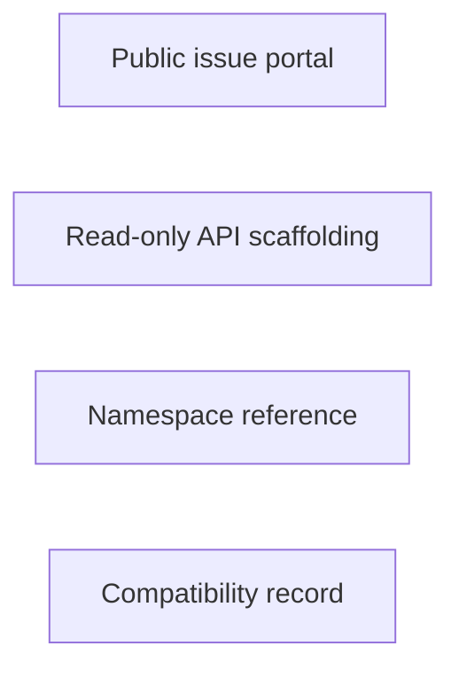

# mlfinlab: workflow, design and architecture

Updated: **2026-10-13**
Reviewed Git hash: `c6bda44c397938a498dff307c4589400bf734c84`
Branch: `feature/ayu_develop`
Source diff SHA256: `e3b0c44298fc1c149afbf4c8996fb92427ae41e4649b934ca495991b7852b855`
Scope: **Retired reference** / Maintenance: **reference**
Languages: Python

[HTML edition](ayu-develop.html) / [Development](development.md) / [Historical validation](validation.md) / [Full system comparison](../../docs/index.html)

## Purpose and scope

Public issue and API reference portal for the commercial MlFinLab library; the inspected checkout is predominantly algorithm scaffolding, not a validated executable research engine.

## Features and support boundaries

Native = implemented here. Integration = supplied through a named host/API. Limited = material restriction. Not provided = evidenced scope exclusion. Unverified = support/absence not established. Not applicable = outside this artifact type.

| Capability | Status | Implementation and limits | Source |
|---|---|---|---|
| Backtesting | Not applicable | No maintained executable trading/research runtime is established by this reference checkout. | [README.md](../README.md) ([L17](https://github.com/alexcwyu/mlfinlab/blob/c6bda44c397938a498dff307c4589400bf734c84/README.md#L17)) |
| Live execution | Not applicable | No maintained executable trading/research runtime is established by this reference checkout. | [README.md](../README.md) ([L17](https://github.com/alexcwyu/mlfinlab/blob/c6bda44c397938a498dff307c4589400bf734c84/README.md#L17)) |
| Paper trading | Not applicable | No maintained executable trading/research runtime is established by this reference checkout. | [README.md](../README.md) ([L17](https://github.com/alexcwyu/mlfinlab/blob/c6bda44c397938a498dff307c4589400bf734c84/README.md#L17)) |
| Event driven | Not applicable | No maintained executable trading/research runtime is established by this reference checkout. | [README.md](../README.md) ([L17](https://github.com/alexcwyu/mlfinlab/blob/c6bda44c397938a498dff307c4589400bf734c84/README.md#L17)) |
| Vectorized | Not applicable | No maintained executable trading/research runtime is established by this reference checkout. | [README.md](../README.md) ([L17](https://github.com/alexcwyu/mlfinlab/blob/c6bda44c397938a498dff307c4589400bf734c84/README.md#L17)) |
| Order management | Not applicable | No maintained executable trading/research runtime is established by this reference checkout. | [README.md](../README.md) ([L17](https://github.com/alexcwyu/mlfinlab/blob/c6bda44c397938a498dff307c4589400bf734c84/README.md#L17)) |
| Order types | Not applicable | No maintained executable trading/research runtime is established by this reference checkout. | [README.md](../README.md) ([L17](https://github.com/alexcwyu/mlfinlab/blob/c6bda44c397938a498dff307c4589400bf734c84/README.md#L17)) |
| Multi venue | Not applicable | No maintained executable trading/research runtime is established by this reference checkout. | [README.md](../README.md) ([L17](https://github.com/alexcwyu/mlfinlab/blob/c6bda44c397938a498dff307c4589400bf734c84/README.md#L17)) |
| Crypto | Not applicable | No maintained executable trading/research runtime is established by this reference checkout. | [README.md](../README.md) ([L17](https://github.com/alexcwyu/mlfinlab/blob/c6bda44c397938a498dff307c4589400bf734c84/README.md#L17)) |
| Equities | Not applicable | No maintained executable trading/research runtime is established by this reference checkout. | [README.md](../README.md) ([L17](https://github.com/alexcwyu/mlfinlab/blob/c6bda44c397938a498dff307c4589400bf734c84/README.md#L17)) |
| Futures | Not applicable | No maintained executable trading/research runtime is established by this reference checkout. | [README.md](../README.md) ([L17](https://github.com/alexcwyu/mlfinlab/blob/c6bda44c397938a498dff307c4589400bf734c84/README.md#L17)) |
| Options | Not applicable | No maintained executable trading/research runtime is established by this reference checkout. | [README.md](../README.md) ([L17](https://github.com/alexcwyu/mlfinlab/blob/c6bda44c397938a498dff307c4589400bf734c84/README.md#L17)) |
| Forex | Not applicable | No maintained executable trading/research runtime is established by this reference checkout. | [README.md](../README.md) ([L17](https://github.com/alexcwyu/mlfinlab/blob/c6bda44c397938a498dff307c4589400bf734c84/README.md#L17)) |
| Strategy api | Not applicable | No maintained executable trading/research runtime is established by this reference checkout. | [README.md](../README.md) ([L17](https://github.com/alexcwyu/mlfinlab/blob/c6bda44c397938a498dff307c4589400bf734c84/README.md#L17)) |
| Optimization | Not applicable | No maintained executable trading/research runtime is established by this reference checkout. | [README.md](../README.md) ([L17](https://github.com/alexcwyu/mlfinlab/blob/c6bda44c397938a498dff307c4589400bf734c84/README.md#L17)) |
| Machine learning | Not applicable | No maintained executable trading/research runtime is established by this reference checkout. | [README.md](../README.md) ([L17](https://github.com/alexcwyu/mlfinlab/blob/c6bda44c397938a498dff307c4589400bf734c84/README.md#L17)) |
| Reinforcement learning | Not applicable | No maintained executable trading/research runtime is established by this reference checkout. | [README.md](../README.md) ([L17](https://github.com/alexcwyu/mlfinlab/blob/c6bda44c397938a498dff307c4589400bf734c84/README.md#L17)) |
| Portfolio | Not applicable | No maintained executable trading/research runtime is established by this reference checkout. | [README.md](../README.md) ([L17](https://github.com/alexcwyu/mlfinlab/blob/c6bda44c397938a498dff307c4589400bf734c84/README.md#L17)) |
| Risk management | Not applicable | No maintained executable trading/research runtime is established by this reference checkout. | [README.md](../README.md) ([L17](https://github.com/alexcwyu/mlfinlab/blob/c6bda44c397938a498dff307c4589400bf734c84/README.md#L17)) |
| Performance analytics | Not applicable | No maintained executable trading/research runtime is established by this reference checkout. | [README.md](../README.md) ([L17](https://github.com/alexcwyu/mlfinlab/blob/c6bda44c397938a498dff307c4589400bf734c84/README.md#L17)) |
| Historical data | Not applicable | No maintained executable trading/research runtime is established by this reference checkout. | [README.md](../README.md) ([L17](https://github.com/alexcwyu/mlfinlab/blob/c6bda44c397938a498dff307c4589400bf734c84/README.md#L17)) |
| Streaming data | Not applicable | No maintained executable trading/research runtime is established by this reference checkout. | [README.md](../README.md) ([L17](https://github.com/alexcwyu/mlfinlab/blob/c6bda44c397938a498dff307c4589400bf734c84/README.md#L17)) |
| Persistence | Not applicable | No maintained executable trading/research runtime is established by this reference checkout. | [README.md](../README.md) ([L17](https://github.com/alexcwyu/mlfinlab/blob/c6bda44c397938a498dff307c4589400bf734c84/README.md#L17)) |
| Data pipeline | Not applicable | No maintained executable trading/research runtime is established by this reference checkout. | [README.md](../README.md) ([L17](https://github.com/alexcwyu/mlfinlab/blob/c6bda44c397938a498dff307c4589400bf734c84/README.md#L17)) |
| Web ui | Not applicable | No maintained executable trading/research runtime is established by this reference checkout. | [README.md](../README.md) ([L17](https://github.com/alexcwyu/mlfinlab/blob/c6bda44c397938a498dff307c4589400bf734c84/README.md#L17)) |
| Cli | Not applicable | No maintained executable trading/research runtime is established by this reference checkout. | [README.md](../README.md) ([L17](https://github.com/alexcwyu/mlfinlab/blob/c6bda44c397938a498dff307c4589400bf734c84/README.md#L17)) |
| Monitoring | Not applicable | No maintained executable trading/research runtime is established by this reference checkout. | [README.md](../README.md) ([L17](https://github.com/alexcwyu/mlfinlab/blob/c6bda44c397938a498dff307c4589400bf734c84/README.md#L17)) |
| Extension api | Not applicable | No maintained executable trading/research runtime is established by this reference checkout. | [README.md](../README.md) ([L17](https://github.com/alexcwyu/mlfinlab/blob/c6bda44c397938a498dff307c4589400bf734c84/README.md#L17)) |
| Native acceleration | Not applicable | No maintained executable trading/research runtime is established by this reference checkout. | [README.md](../README.md) ([L17](https://github.com/alexcwyu/mlfinlab/blob/c6bda44c397938a498dff307c4589400bf734c84/README.md#L17)) |
| Distributed execution | Not applicable | No maintained executable trading/research runtime is established by this reference checkout. | [README.md](../README.md) ([L17](https://github.com/alexcwyu/mlfinlab/blob/c6bda44c397938a498dff307c4589400bf734c84/README.md#L17)) |

## System components

| Component | Responsibility | Source |
|---|---|---|
| Public issue portal | Public facing issue portal; advertised commercial algorithms are not proof of local implementation. | [README.md](../README.md) ([L17](https://github.com/alexcwyu/mlfinlab/blob/c6bda44c397938a498dff307c4589400bf734c84/README.md#L17)) |
| Read-only API scaffolding | Constructor, batch_run, run and rolling bar helpers inspected: bodies are pass; CSV assertions are real but do not implement bar construction. | [BaseBars](../src/mlfinlab/data_structures/base_bars.py) ([L30](https://github.com/alexcwyu/mlfinlab/blob/c6bda44c397938a498dff307c4589400bf734c84/src/mlfinlab/data_structures/base_bars.py#L30)) |
| Namespace reference | Published package namespace imports research modules; imports do not prove their algorithm bodies. | [src/mlfinlab/__init__.py](../src/mlfinlab/__init__.py) ([L8](https://github.com/alexcwyu/mlfinlab/blob/c6bda44c397938a498dff307c4589400bf734c84/src/mlfinlab/__init__.py#L8)) |
| Compatibility record | Current validation explicitly records pass bodies and no supplied tests; Python 3.13 fallback is dependency compatibility, not algorithm verification. | [docs/validation.md](../docs/validation.md) ([L21](https://github.com/alexcwyu/mlfinlab/blob/c6bda44c397938a498dff307c4589400bf734c84/docs/validation.md#L15)) |

## Architecture and component boundaries

The component view summarizes inspected responsibility boundaries. Arrows identify the documented API/data dependencies; this is not a deployment-readiness claim.

## Design decisions

| Decision | Rationale | Tradeoff | Evidence |
|---|---|---|---|
| Keep this checkout in the reference section. | Public issue and API reference portal for the commercial MlFinLab library; the inspected checkout is predominantly algorithm scaffolding, not a validated executable research engine. | External product or replacement repository must be inspected separately before assuming runtime capabilities. | [README.md](../README.md) ([L17](https://github.com/alexcwyu/mlfinlab/blob/c6bda44c397938a498dff307c4589400bf734c84/README.md#L17)) |

## Class and interface relationships

No executable class/interface graph applies to this repository scope. The source review does not invent classes for retired/reference-only material.

## Workflow

There is no executable workflow in this retired/reference scope. See the source map for the current repository contents.

## Sequence

No runtime call sequence applies to this repository scope.

## Strengths and limits

### Strengths

- Public issue and API reference portal for the commercial MlFinLab library; the inspected checkout is predominantly algorithm scaffolding, not a validated executable research engine. [README.md](../README.md) ([L17](https://github.com/alexcwyu/mlfinlab/blob/c6bda44c397938a498dff307c4589400bf734c84/README.md#L17))

### Limitations

- Commercial/library claims and the remaining _assert_csv helper must not turn the empty public algorithm bodies into native capabilities. [BaseBars](../src/mlfinlab/data_structures/base_bars.py) ([L30](https://github.com/alexcwyu/mlfinlab/blob/c6bda44c397938a498dff307c4589400bf734c84/src/mlfinlab/data_structures/base_bars.py#L30))

## Validation scope

The linked validation and command records preserve actual historical runs and user-authorized exclusions. This source/document review does not rerun application tests, establish live trading readiness or rank benchmark performance. Current data, credential and runtime prerequisites remain material.

[Repository validation](validation.md) / [Executed checks](maintenance/index.md)

## Source map

| Reviewed symbol/path | Inspected responsibility | Actual file SHA256 |
|---|---|---|
| [README.md](../README.md) ([L17](https://github.com/alexcwyu/mlfinlab/blob/c6bda44c397938a498dff307c4589400bf734c84/README.md#L17)) | Public facing issue portal; advertised commercial algorithms are not proof of local implementation. | `22bf05e1c98e4f0d518708c79d3316626e581a3c0dfb4e69ba1d4e3788ad36bb` |
| [BaseBars](../src/mlfinlab/data_structures/base_bars.py) ([L30](https://github.com/alexcwyu/mlfinlab/blob/c6bda44c397938a498dff307c4589400bf734c84/src/mlfinlab/data_structures/base_bars.py#L30)) | Constructor, batch_run, run and rolling bar helpers inspected: bodies are pass; CSV assertions are real but do not implement bar construction. | `b079cd2d0cd92eba6fb29fa9706fa18429cd1e3f3faa36b1dfb0df64bee63971` |
| [src/mlfinlab/__init__.py](../src/mlfinlab/__init__.py) ([L8](https://github.com/alexcwyu/mlfinlab/blob/c6bda44c397938a498dff307c4589400bf734c84/src/mlfinlab/__init__.py#L8)) | Published package namespace imports research modules; imports do not prove their algorithm bodies. | `37ebbb9e41b87b9bfb78b4b67944046cb22925d72935d624c95ff4c67214c8e6` |
| [docs/validation.md](../docs/validation.md) ([L21](https://github.com/alexcwyu/mlfinlab/blob/c6bda44c397938a498dff307c4589400bf734c84/docs/validation.md#L15)) | Current validation explicitly records pass bodies and no supplied tests; Python 3.13 fallback is dependency compatibility, not algorithm verification. | `896c81d7bcd9ba5918d3c21f9a5a86d49f1e93674f79b4ff6453e38ef2b1a2dd` |

## Documentation provenance

Review date: 2026-10-13. Full committed source HEAD: `c6bda44c397938a498dff307c4589400bf734c84`. Template version: 2. 4 source files were independently hashed for this guide.

[Evidence catalog](../../docs/systems-2026-10-13/catalog.json) / [Standard template](../../docs/guidelines/APP_TEMPLATE.md)

- Read README.md, src/mlfinlab/__init__.py, src/mlfinlab/data_structures/base_bars.py and docs/validation.md. Runtime classes/workflows deliberately omitted for this reference checkout.
- Commercial/library claims and the remaining _assert_csv helper must not turn the empty public algorithm bodies into native capabilities.
